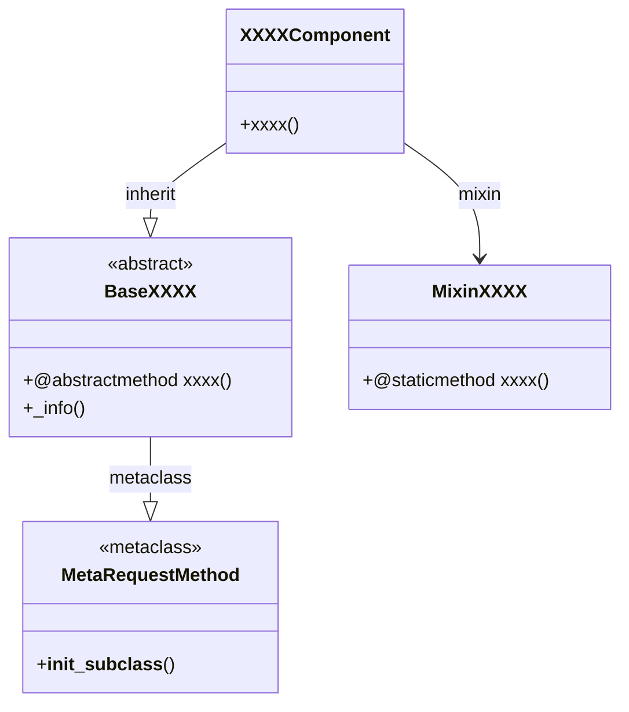

# StatJAX

English | [中文](README_Chinese.md)

## 1.introduce
### 1.1 StatJAX positioning
+ StatJAX is a statistical model algorithm package based on the jax technology stack starting from the matrix calculation level and implemented from the bottom up. I initiated this open source project for the following three purposes:
	+ Real knowledge comes from practice, and you can deepen your understanding of statistical model algorithms by "reinventing the wheel".
	+ Stand on the shoulders of giants and take a small step forward. Based on the JAX technology stack, expand the implementation boundaries of well-known statistical algorithm packages such as statsmodels and scikit learn (such as GPU implementation)
	+ It provides a learning reference for students of probability and statistics.

## 2.design
### 2.1 core concepts
+ **base (module base class)**: base is a module base class implemented using metaprogramming technology. Its main function is to standardize the method behavior of each module, so that different algorithm engineers can jointly develop research algorithms under the same standard, and agile algorithm operation and maintenance and development.
+ **component (algorithm component)**: component is the specific implementation of each algorithm, inherited from the base module base class (different algorithm base class specifications have different method behaviors), its main function is used to implement specific algorithms, and is the main operation, maintenance and development part of the algorithm engineer, and can be independently opened.
+ **algo (application component)**: algo is an open component that combines various algorithm components based on mixins. Its main function is to realize a complete algorithm application flow.

### 2.2 frame


+ **MetaRequestMethod**: a metaclass based on `__init_subclass__`, which checks whether a subclass implements all agreed abstract methods before the class is created.
+ **BaseXXXX**: an abstract module base class, which standardizes the unified interface methods of each module (such as `train`, `reasoning`, `_info`).
+ **XXXXComponent**: the concrete implementation of an algorithm, the main technical JAX technology stack.
+ **MixinXXXX**: the concrete implementation of algorithm auxiliary functions, based on the Mixin mode and static methods.

## 3.use
### 3.1 How to get
```bash
git clone https://github.com/redblue0216/statjax.git
cd statjax
conda create -n statjax python=3.13 -y
conda activate statjax
python build.py --clean --install
```

### 3.2 How to use
```python
import jax
import jax.numpy as jnp
from jax.scipy.stats import norm
from statjax.regression import HouseholderOLSComponent, SVDRidgeComponent, CDLassoComponent, QRLogisticComponent, QRProbitComponent, QRMultinomialLogisticComponent, GHKMultinomialProbitComponent, SMOSVRComponent, SMOMulticlassSVMComponent

# Prepare the training data (column full rank design matrix A and observation labels b)
A_train = jax.random.normal(jax.random.PRNGKey(0), (100, 5))
b_train = A_train @ jnp.array([1.2, -2.1, 0.7, 3.3, -1.5])

# Train the OLS model and solve the optimal regression coefficients
ols = HouseholderOLSComponent()
x_hat, metrics = ols.train(A=A_train, b=b_train)

# Batch prediction on the test set
y_pred = ols.reasoning(A_test=A_train)

# Train the ridge regression model with L2 regularization coefficient lambda
ridge = SVDRidgeComponent(lam=1.0)
w_hat, metrics = ridge.train(A=A_train, b=b_train)
y_pred = ridge.reasoning(A_test=A_train)

# Train the LASSO regression model with L1 regularization coefficient lambda
lasso = CDLassoComponent(lam=0.01)
w_hat, metrics = lasso.train(A=A_train, b=b_train)
y_pred = lasso.reasoning(A_test=A_train)

# Train binary Logistic regression on labels containing only 0 and 1
binary_labels = jax.random.bernoulli(
    jax.random.PRNGKey(1), jax.nn.sigmoid(0.35 + A_train @ x_hat)
).astype(jnp.float64)
logistic = QRLogisticComponent(l2=1e-6)
beta_hat, metrics = logistic.train(A=A_train, b=binary_labels)
probabilities = logistic.predict_proba(A_test=A_train)
class_pred = logistic.reasoning(A_test=A_train)

# Train binary Probit regression; the caller supplies the intercept column
A_probit = jnp.concatenate([jnp.ones((A_train.shape[0], 1)), A_train], axis=1)
probit_true = jnp.array([0.35, 1.2, -2.1, 0.7, 3.3, -1.5])
probit_labels = jax.random.bernoulli(
    jax.random.PRNGKey(2), norm.cdf(A_probit @ probit_true)
).astype(jnp.float64)
probit = QRProbitComponent()
probit_beta, metrics = probit.train(A=A_probit, b=probit_labels)
probabilities = probit.predict_proba(A_test=A_probit)
class_pred = probit.reasoning(A_test=A_probit)

# Train multinomial Logistic regression with explicit K and integer labels 0,...,K-1
multi_true = jax.random.normal(jax.random.PRNGKey(3), (5, 3))
multi_labels = jax.random.categorical(
    jax.random.PRNGKey(4), A_train @ multi_true, axis=1
).astype(jnp.int32)
multinomial = QRMultinomialLogisticComponent(n_classes=3, l2=1e-4)
theta_hat, metrics = multinomial.train(A=A_train, b=multi_labels)
probabilities = multinomial.predict_proba(A_test=A_train)  # (n, 3), reference class last
class_pred = multinomial.reasoning(A_test=A_train)         # int32 argmax labels

# Train multinomial Probit on A(n,D,p); D=J-1 and the final class is the reference
mnp_keys = jax.random.split(jax.random.PRNGKey(5), 2)
A_mnp = jax.random.normal(mnp_keys[0], (100, 2, 3), dtype=jnp.float64)
mnp_errors = jax.random.normal(mnp_keys[1], (100, 2), dtype=jnp.float64)
mnp_beta = jnp.array([0.8, -0.5, 0.6], dtype=jnp.float64)
mnp_L = jnp.array([[1.0, 0.0], [0.35, 0.8]], dtype=jnp.float64)
mnp_utilities = jnp.concatenate([
    jnp.einsum("ndp,p->nd", A_mnp, mnp_beta) + mnp_errors @ mnp_L.T,
    jnp.zeros((100, 1), dtype=jnp.float64),
], axis=1)
mnp_labels = jnp.argmax(mnp_utilities, axis=1).astype(jnp.int32)
mnp = GHKMultinomialProbitComponent(num_draws=128)
mnp_theta, metrics = mnp.train(A=A_mnp, b=mnp_labels)
probabilities = mnp.predict_proba(A_test=A_mnp)  # (n, 3), independent inference draws
class_pred = mnp.reasoning(A_test=A_mnp)         # int32 argmax labels

# Train exact RBF support vector regression with a fully compiled SMO loop
A_svr = jnp.linspace(-3.0, 3.0, 40, dtype=jnp.float64)[:, None]
b_svr = jnp.sin(A_svr[:, 0])
svr = SMOSVRComponent(C=10.0, epsilon=0.05, gamma=0.5)
svr_beta, metrics = svr.train(A=A_svr, b=b_svr)  # complete compact dual, (40,)
y_pred = svr.reasoning(A_test=A_svr)             # original target scale, (40,)

# Train multiclass C-SVM with RBF kernels and OvO/OvR decomposition (distinct from SVR)
A_svm = jnp.array([[-2.0, -2.0], [-2.2, -1.8], [2.0, -2.0], [2.2, -1.8], [0.0, 2.2], [0.2, 2.0]], dtype=jnp.float64)
b_svm = jnp.array([0, 0, 1, 1, 2, 2], dtype=jnp.int32)
for strategy in ("ovo", "ovr"):
    svm = SMOMulticlassSVMComponent(C=2.0, gamma=0.5, strategy=strategy)
    alpha_hat, metrics = svm.train(A=A_svm, b=b_svm)
    class_pred = svm.reasoning(A_test=A_svm)  # int32 classes, not probabilities
```

Runnable end-to-end demos:

```bash
python example/example_001.py   # OLS (Householder QR)
python example/example_002.py   # Ridge regression (SVD)
python example/example_003.py   # LASSO (coordinate descent)
python example/example_004.py   # Binary Logistic regression (IRLS + pivoted QR)
python example/example_005.py   # Binary Probit regression (Fisher scoring + pivoted QR)
python example/example_006.py   # Multinomial Logistic regression (whitened IRLS + handwritten pivoted QR)
python example/example_007.py   # Multinomial Probit regression (Cholesky + GHK + MSL + BFGS)
python example/example_008.py   # RBF support vector regression (second-order SMO)
python example/example_009.py   # Multiclass C-SVM (RBF kernel, OvO/OvR and second-order SMO)
```

Run unit tests:

```bash
pip install pytest
python -m pytest -v
```

For the complete self-test process from scratch, see [StatJAX自我测试完整流程_SH_V009.md](design/StatJAX自我测试完整流程_SH_V009.md).

### 3.3 design
<details>
<summary>Click to view design documents (27 files)</summary>

| File | Description |
|:----|:----|
| [StatJAX设计_SH_V001.md](design/StatJAX设计_SH_V001.md) | Overall design of StatJAX: core concepts (base / component / algo) and the framework architecture |
| [StatJAX001_实施方案_SH_V001.md](design/StatJAX001_实施方案_SH_V001.md) | Implementation plan for the StatJAX001 iteration |
| [StatJAX001_OLS_SH_V003.md](design/StatJAX001_OLS_SH_V003.md) | OLS algorithm document: Householder QR decomposition for ordinary least squares |
| [StatJAX002_实施方案_SH_V001.md](design/StatJAX002_实施方案_SH_V001.md) | Implementation plan for the StatJAX002 iteration |
| [StatJAX002_岭回归_SH_V002.md](design/StatJAX002_岭回归_SH_V002.md) | Ridge regression algorithm document: SVD-based ridge regression |
| [StatJAX003_实施方案_SH_V001.md](design/StatJAX003_实施方案_SH_V001.md) | Implementation plan for the StatJAX003 iteration |
| [StatJAX003_LASSO_SH_V001.md](design/StatJAX003_LASSO_SH_V001.md) | LASSO algorithm document: coordinate descent for L1-regularized regression |
| [StatJAX004_实施方案_SH_V001.md](design/StatJAX004_实施方案_SH_V001.md) | Implementation plan for the StatJAX004 iteration |
| [StatJAX004_logistic_SH_V001.md](design/StatJAX004_logistic_SH_V001.md) | Logistic algorithm document: IRLS, column-pivoted Householder QR and Armijo backtracking |
| [StatJAX005_实施方案_SH_V001.md](design/StatJAX005_实施方案_SH_V001.md) | Implementation plan for the StatJAX005 iteration |
| [StatJAX005_Probit_SH_V001.md](design/StatJAX005_Probit_SH_V001.md) | Probit algorithm document: Fisher scoring, column-pivoted Householder QR and Armijo step halving |
| [StatJAX006_实施方案_SH_V001.md](design/StatJAX006_实施方案_SH_V001.md) | Implementation plan for the StatJAX006 iteration |
| [StatJAX006_多分类logistic_SH_V001.md](design/StatJAX006_多分类logistic_SH_V001.md) | Multinomial Logistic algorithm document: reference-category Softmax, whitened IRLS, handwritten pivoted QR and Armijo backtracking |
| [StatJAX007_实施方案_SH_V001.md](design/StatJAX007_实施方案_SH_V001.md) | Implementation plan for the StatJAX007 iteration |
| [StatJAX007_多分类probit_SH_V001.md](design/StatJAX007_多分类probit_SH_V001.md) | Multinomial Probit algorithm document: scale-constrained Cholesky, GHK, fixed-draw MSL and automatic-differentiation BFGS |
| [StatJAX008_实施方案_SH_V001.md](design/StatJAX008_实施方案_SH_V001.md) | Implementation plan for the StatJAX008 iteration |
| [StatJAX008_SVM_SH_V001.md](design/StatJAX008_SVM_SH_V001.md) | Support vector regression algorithm document: RBF kernels, compact duals, second-order SMO and fully compiled device-side iteration |
| [StatJAX009_实施方案_SH_V001.md](design/StatJAX009_实施方案_SH_V001.md) | Implementation plan for the StatJAX009 iteration |
| [StatJAX009_多分类SVM_SH_V001.md](design/StatJAX009_多分类SVM_SH_V001.md) | Multiclass C-SVM algorithm document: RBF kernels, OvO/OvR decomposition, second-order SMO and fully compiled device-side iteration |
| [StatJAX自我测试完整流程_SH_V002.md](design/StatJAX自我测试完整流程_SH_V002.md) | Complete self-test process of StatJAX from scratch (for statjax 0.2.1) |
| [StatJAX自我测试完整流程_SH_V003.md](design/StatJAX自我测试完整流程_SH_V003.md) | Complete self-test process of StatJAX from scratch (for statjax 0.3.1) |
| [StatJAX自我测试完整流程_SH_V004.md](design/StatJAX自我测试完整流程_SH_V004.md) | Complete self-test process of StatJAX from scratch (for statjax 0.4.1) |
| [StatJAX自我测试完整流程_SH_V005.md](design/StatJAX自我测试完整流程_SH_V005.md) | Complete self-test process of StatJAX from scratch (for statjax 0.5.1) |
| [StatJAX自我测试完整流程_SH_V006.md](design/StatJAX自我测试完整流程_SH_V006.md) | Complete self-test process of StatJAX from scratch (for statjax 0.6.1) |
| [StatJAX自我测试完整流程_SH_V007.md](design/StatJAX自我测试完整流程_SH_V007.md) | Complete self-test process of StatJAX from scratch (for statjax 0.7.1) |
| [StatJAX自我测试完整流程_SH_V008.md](design/StatJAX自我测试完整流程_SH_V008.md) | Complete self-test process of StatJAX from scratch (for statjax 0.8.1) |
| [StatJAX自我测试完整流程_SH_V009.md](design/StatJAX自我测试完整流程_SH_V009.md) | Complete self-test process of StatJAX from scratch (for statjax 0.9.1) |
</details>

## 4.algorithm
### 4.1 Which algorithms and models are covered?

| Module | Component | Algorithm | Key features |
|:----|:----|:----|:----|
| regression | HouseholderOLSComponent | Ordinary least squares (OLS) solved by Householder QR decomposition: min ‖A·x − b‖₂², equivalently transformed into R·x̂ = Qᵀ·b | Optimal numerical stability (no condition number squaring); fully differentiable, JIT-compilable and GPU-accelerated based on JAX |
| regression | SVDRidgeComponent | Ridge regression solved by SVD decomposition: min ‖X·w − y‖₂² + λ·‖w‖₂², reduced to per-singular-component shrinkage ŵ = V·diag(σᵢ/(σᵢ²+λ))·Uᵀ·y | Natively carries L2 regularization; numerically stable under multicollinearity and rank deficiency; fully differentiable, JIT-compilable and GPU-accelerated based on JAX |
| regression | CDLassoComponent | LASSO solved by coordinate descent: min ½‖y − X·β‖₂² + λ·‖β‖₁, per-coordinate exact minimization with the soft thresholding operator β_j = soft(z_j, λ)/s_j and rank-1 residual update | Exactly sparse solutions with feature selection; no matrix decomposition required, high-dimensional friendly; KKT optimality verification (JAX native); fully differentiable, JIT-compilable and GPU-accelerated based on JAX |
| regression | QRLogisticComponent | Binary Logistic regression with mean cross-entropy and L2-regularized weights, solved by IRLS and column-pivoted Householder QR with numerical-rank truncation and Armijo backtracking | Stable logaddexp loss; unpenalized intercept; training-only standardization; two-column probabilities and binary classes; selective JIT for loss, gradient and inference, while dynamic-rank QR remains host-controlled |
| regression | QRProbitComponent | Unregularized binary Probit maximum-likelihood estimation solved by Fisher scoring/IRLS and column-pivoted Householder QR, with numerical-rank errors and Armijo step halving | Stable normal log-CDF likelihood; caller-prepared intercept and preprocessing; two-column normal-CDF probabilities and binary classes; selective JIT matrix kernels with host-controlled diagnostics |
| regression | QRMultinomialLogisticComponent | Multinomial Logistic regression with reference-category Softmax and unaveraged L2-regularized cross-entropy, solved by jointly coupled IRLS, per-sample Cholesky whitening and handwritten column-pivoted Householder QR with Armijo backtracking | Explicit K and training-only standardization; unpenalized intercepts; K-column probabilities and int32 argmax classes; selective JIT matrix kernels with host-controlled line search; intended for small and medium dense data |
| regression | GHKMultinomialProbitComponent | Correlated multinomial Probit regression with a final reference class and Sigma[0,0]=1, solved by scale-constrained Cholesky parameterization, class contrasts, GHK simulation, fixed-common-random-number MSL and automatic-differentiation BFGS | Three-dimensional A(n,D,p) with D=J-1; caller-controlled alternative encoding and preprocessing; J-column probabilities from independent inference draws with optional row normalization; int32 argmax classes; intended for small and medium dense data |
| regression | SMOSVRComponent | Exact RBF support vector regression solved through the compact dual, KKT maximum-violation selection, second-order working sets and exact piecewise-quadratic pair updates | Training-only X/y standardization; O(n) incremental gradients; fully JIT-compiled lax.while_loop; sparse support-vector predictions with inverse standardization; O(n²) kernel memory and small/medium dense-data boundary |
| regression | SMOMulticlassSVMComponent | Exact RBF multiclass C-SVM solved by OvO/OvR decomposition, KKT maximum-violation selection, second-order working sets and analytic pair updates | Fully JIT-compiled fixed-shape lax.while_loop; O(n) incremental gradients; correctly signed bias recovery and per-binary diagnostics; OvO voting and OvR maximum-score int32 classes without probability outputs; O(n²) kernel memory and small/medium dense-data boundary |

## 5.ChangeLog
<details>
<summary>Click to view ChangeLog</summary>

### Version-0.9.1
  - Added the regression component SMOMulticlassSVMComponent (RBF kernel, OvO/OvR decomposition, second-order SMO, analytic pair updates and fully compiled lax.while_loop)
  - Added the unit test file statjax/tests/test_multiclass_svm.py with 28 kernel, KKT, dual-constraint, bias-sign, inference and validation tests
  - Updated example/example_009.py to use the public component with reproducibility and numerical diagnostics
  - Corrected the multiclass SVM bias-recovery sign in code, comments and the StatJAX009 algorithm document
  - Deepened project-wide comments, integrating the overall design and multiclass C-SVM algorithm document (StatJAX009)
  - Updated the self-test process document to StatJAX自我测试完整流程_SH_V009.md

### Version-0.8.1
  - Added the regression component SMOSVRComponent (RBF kernel, compact dual, second-order SMO, exact pair subproblems and fully compiled lax.while_loop)
  - Added the unit test file statjax/tests/test_svr.py with 17 kernel, KKT, dual-constraint, inference and validation tests
  - Updated example/example_008.py to use the public component with reproducibility and numerical diagnostics
  - Deepened project-wide comments, integrating the overall design and support vector regression algorithm document (StatJAX008)
  - Updated the self-test process document to StatJAX自我测试完整流程_SH_V008.md

### Version-0.7.1
  - Added the regression component GHKMultinomialProbitComponent (scale-constrained Cholesky, class contrasts, GHK, fixed-draw MSL and automatic-differentiation BFGS)
  - Added the unit test file statjax/tests/test_multinomial_probit.py with 17 numerical, simulation, inference and validation tests
  - Updated example/example_007.py to use the public component and NumPy-based independent CDF checks without a SciPy dependency
  - Deepened project-wide comments, integrating the overall design and multinomial Probit algorithm document (StatJAX007)
  - Updated the self-test process document to StatJAX自我测试完整流程_SH_V007.md

### Version-0.6.1
  - Added the regression component QRMultinomialLogisticComponent (reference-category Softmax, jointly coupled IRLS, per-sample whitening and handwritten column-pivoted Householder QR)
  - Added the unit test file statjax/tests/test_multinomial_logistic.py with 17 numerical, inference and validation tests
  - Deepened project-wide comments, integrating the overall design and multinomial Logistic algorithm document (StatJAX006)
  - Updated the self-test process document to StatJAX自我测试完整流程_SH_V006.md

### Version-0.5.1
  - Added the regression component QRProbitComponent (binary Probit regression based on Fisher scoring and column-pivoted Householder QR)
  - Added the unit test file statjax/tests/test_probit.py with 15 numerical, inference and validation tests
  - Deepened project-wide comments, integrating the overall design and Probit algorithm document (StatJAX005)
  - Updated the self-test process document to StatJAX自我测试完整流程_SH_V005.md

### Version-0.4.1
  - Added the regression component QRLogisticComponent (binary Logistic regression based on IRLS and column-pivoted Householder QR)
  - Added the unit test file statjax/tests/test_logistic.py with 12 numerical, inference and validation tests
  - Deepened project-wide comments, integrating the overall design and Logistic algorithm document (StatJAX004)
  - Updated the self-test process document to StatJAX自我测试完整流程_SH_V004.md

### Version-0.3.1
  - Added the regression component CDLassoComponent (LASSO regression based on coordinate descent)
  - Added the unit test file statjax/tests/test_lasso.py
  - Deepened project-wide comments, integrating the LASSO algorithm document (StatJAX003)
  - Updated the self-test process document to StatJAX自我测试完整流程_SH_V003.md

### Version-0.2.1
  - Added the regression component SVDRidgeComponent (ridge regression based on SVD decomposition)
  - Added the unit test file statjax/tests/test_ridge.py
  - Deepened project-wide comments, integrating the ridge regression algorithm document (StatJAX002)

### Version-0.2.0
  - Added the regression component HouseholderOLSComponent (OLS linear regression based on Householder QR decomposition)
  - Added the unit test file statjax/tests/test_ols.py
  - Completed project-wide comments, integrating the design documents and the OLS algorithm document

### Version-0.1.1
  - Algorithm package framework development
</details>
