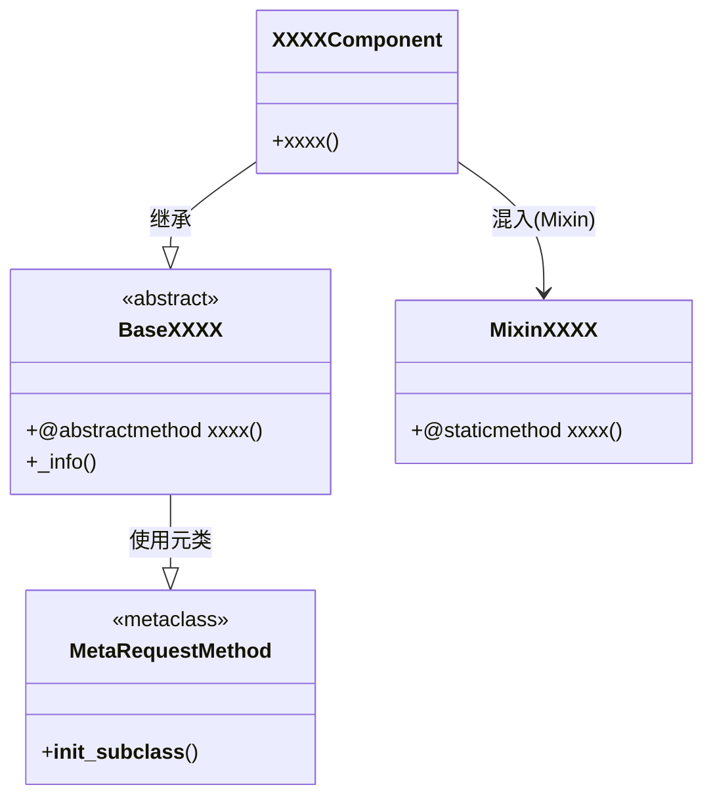

# StatJAX

[English](README.md) | 中文

## 1.介绍
### 1.1 StatJAX定位
+ StatJAX是基于JAX技术栈从矩阵计算层面开始，由下而上实现的统计模型算法包。我发起这个开源项目的目的有以下三点：
	+ 实践出真知，通过“重复造轮子”的方式，加深自己对统计模型算法的理解
	+ 站在巨人的肩上前进一小步，基于JAX技术栈，扩展statsmodels和scikit-learn等知名统计算法包的实现边界（如GPU实现）
	+ 抛砖引玉，为概率统计的学生们，提供一个学习的参考资料。

## 2.设计
### 2.1 核心概念
+ **Base（模块基类）**：Base是采用元编程技术实现的模块基类，主要功能用来规范各个模块的方法行为，便于不同算法工程师在同一个标准下共同开发研究算法，敏捷算法运维和开发。
+ **Component（算法组件）**：Component是各个算法的具体实现，继承自Base模块基类（不同算法基类规范的方法行为不同），主要功能用来实现具体算法，是算法工程师主要运维和开发部分，可独立开放。
+ **Algo（应用组件）**：Algo是对外开放组件，基于Mixin组合各类算法组件，主要功能用来实现完整的算法应用流。

### 2.2 框架


+ **MetaRequestMethod**：基于`__init_subclass__`的元类，在类创建前检查子类是否实现了全部约定的抽象方法。
+ **BaseXXXX**：抽象模块基类，规范各模块的统一接口方法（如`train`、`reasoning`、`_info`）。
+ **XXXXComponent**：算法的具体实现，主要技术JAX技术栈。
+ **MixinXXXX**：算法辅助功能的具体实现，基于Mixin模式和静态方法。

## 3.使用
### 3.1 如何获得
```bash
git clone https://github.com/redblue0216/statjax.git
cd statjax
conda create -n statjax python=3.13 -y
conda activate statjax
python build.py --clean --install
```

### 3.2 如何使用
```python
import jax
import jax.numpy as jnp
from jax.scipy.stats import norm
from statjax.regression import HouseholderOLSComponent, SVDRidgeComponent, CDLassoComponent, QRLogisticComponent, QRProbitComponent, QRMultinomialLogisticComponent, GHKMultinomialProbitComponent, SMOSVRComponent

# 准备训练数据（列满秩设计矩阵A与观测标签b）
A_train = jax.random.normal(jax.random.PRNGKey(0), (100, 5))
b_train = A_train @ jnp.array([1.2, -2.1, 0.7, 3.3, -1.5])

# 训练OLS模型，求解最优回归系数
ols = HouseholderOLSComponent()
x_hat, metrics = ols.train(A=A_train, b=b_train)

# 测试集批量预测
y_pred = ols.reasoning(A_test=A_train)

# 训练岭回归模型，lambda为L2正则系数
ridge = SVDRidgeComponent(lam=1.0)
w_hat, metrics = ridge.train(A=A_train, b=b_train)
y_pred = ridge.reasoning(A_test=A_train)

# 训练LASSO回归模型，lambda为L1正则系数
lasso = CDLassoComponent(lam=0.01)
w_hat, metrics = lasso.train(A=A_train, b=b_train)
y_pred = lasso.reasoning(A_test=A_train)

# 训练二分类Logistic回归，标签只能包含0和1
binary_labels = jax.random.bernoulli(
    jax.random.PRNGKey(1), jax.nn.sigmoid(0.35 + A_train @ x_hat)
).astype(jnp.float64)
logistic = QRLogisticComponent(l2=1e-6)
beta_hat, metrics = logistic.train(A=A_train, b=binary_labels)
probabilities = logistic.predict_proba(A_test=A_train)
class_pred = logistic.reasoning(A_test=A_train)

# 训练二分类Probit回归，截距列由调用方提供
A_probit = jnp.concatenate([jnp.ones((A_train.shape[0], 1)), A_train], axis=1)
probit_true = jnp.array([0.35, 1.2, -2.1, 0.7, 3.3, -1.5])
probit_labels = jax.random.bernoulli(
    jax.random.PRNGKey(2), norm.cdf(A_probit @ probit_true)
).astype(jnp.float64)
probit = QRProbitComponent()
probit_beta, metrics = probit.train(A=A_probit, b=probit_labels)
probabilities = probit.predict_proba(A_test=A_probit)
class_pred = probit.reasoning(A_test=A_probit)

# 训练多分类Logistic回归，显式指定K，标签为0,...,K-1的整数
multi_true = jax.random.normal(jax.random.PRNGKey(3), (5, 3))
multi_labels = jax.random.categorical(
    jax.random.PRNGKey(4), A_train @ multi_true, axis=1
).astype(jnp.int32)
multinomial = QRMultinomialLogisticComponent(n_classes=3, l2=1e-4)
theta_hat, metrics = multinomial.train(A=A_train, b=multi_labels)
probabilities = multinomial.predict_proba(A_test=A_train)  # (n, 3)，参考类别在最后一列
class_pred = multinomial.reasoning(A_test=A_train)         # int32类型的argmax类别

# 训练多分类Probit回归：A(n,D,p)，D=J-1，最后一类为基准
mnp_keys = jax.random.split(jax.random.PRNGKey(5), 2)
A_mnp = jax.random.normal(mnp_keys[0], (100, 2, 3), dtype=jnp.float64)
mnp_errors = jax.random.normal(mnp_keys[1], (100, 2), dtype=jnp.float64)
mnp_beta = jnp.array([0.8, -0.5, 0.6], dtype=jnp.float64)
mnp_L = jnp.array([[1.0, 0.0], [0.35, 0.8]], dtype=jnp.float64)
mnp_utilities = jnp.concatenate([
    jnp.einsum("ndp,p->nd", A_mnp, mnp_beta) + mnp_errors @ mnp_L.T,
    jnp.zeros((100, 1), dtype=jnp.float64),
], axis=1)
mnp_labels = jnp.argmax(mnp_utilities, axis=1).astype(jnp.int32)
mnp = GHKMultinomialProbitComponent(num_draws=128)
mnp_theta, metrics = mnp.train(A=A_mnp, b=mnp_labels)
probabilities = mnp.predict_proba(A_test=A_mnp)  # (n, 3)，使用独立推理随机数
class_pred = mnp.reasoning(A_test=A_mnp)         # int32类型的argmax类别

# 训练精确RBF支持向量回归，SMO循环由JAX完整编译
A_svr = jnp.linspace(-3.0, 3.0, 40, dtype=jnp.float64)[:, None]
b_svr = jnp.sin(A_svr[:, 0])
svr = SMOSVRComponent(C=10.0, epsilon=0.05, gamma=0.5)
svr_beta, metrics = svr.train(A=A_svr, b=b_svr)  # 完整紧凑对偶，形状(40,)
y_pred = svr.reasoning(A_test=A_svr)             # 原始标签尺度，形状(40,)
```

可运行的端到端演示：

```bash
python example/example_001.py   # OLS（Householder QR）
python example/example_002.py   # 岭回归（SVD）
python example/example_003.py   # LASSO（坐标下降）
python example/example_004.py   # 二分类Logistic回归（IRLS + 列主元QR）
python example/example_005.py   # 二分类Probit回归（Fisher scoring + 列主元QR）
python example/example_006.py   # 多分类Logistic回归（白化IRLS + 手写列主元QR）
python example/example_007.py   # 多分类Probit回归（Cholesky + GHK + MSL + BFGS）
python example/example_008.py   # RBF支持向量回归（二阶SMO）
```

运行单元测试：

```bash
pip install pytest
python -m pytest -v
```

从零开始的完整自我测试流程见 [StatJAX自我测试完整流程_SH_V008.md](design/StatJAX自我测试完整流程_SH_V008.md)。

### 3.3 设计
<details>
<summary>点击查看设计文档（共24份）</summary>

| 文件 | 说明 |
|:----|:----|
| [StatJAX设计_SH_V001.md](design/StatJAX设计_SH_V001.md) | StatJAX总体设计：核心概念（base / component / algo）与框架架构 |
| [StatJAX001_实施方案_SH_V001.md](design/StatJAX001_实施方案_SH_V001.md) | StatJAX001迭代的实施方案 |
| [StatJAX001_OLS_SH_V003.md](design/StatJAX001_OLS_SH_V003.md) | OLS算法文档：基于Householder QR分解求解普通最小二乘 |
| [StatJAX002_实施方案_SH_V001.md](design/StatJAX002_实施方案_SH_V001.md) | StatJAX002迭代的实施方案 |
| [StatJAX002_岭回归_SH_V002.md](design/StatJAX002_岭回归_SH_V002.md) | Ridge回归算法文档：基于SVD分解的岭回归 |
| [StatJAX003_实施方案_SH_V001.md](design/StatJAX003_实施方案_SH_V001.md) | StatJAX003迭代的实施方案 |
| [StatJAX003_LASSO_SH_V001.md](design/StatJAX003_LASSO_SH_V001.md) | LASSO算法文档：基于坐标下降法求解L1正则回归 |
| [StatJAX004_实施方案_SH_V001.md](design/StatJAX004_实施方案_SH_V001.md) | StatJAX004迭代的实施方案 |
| [StatJAX004_logistic_SH_V001.md](design/StatJAX004_logistic_SH_V001.md) | Logistic算法文档：IRLS、列主元Householder QR与Armijo回溯 |
| [StatJAX005_实施方案_SH_V001.md](design/StatJAX005_实施方案_SH_V001.md) | StatJAX005迭代的实施方案 |
| [StatJAX005_Probit_SH_V001.md](design/StatJAX005_Probit_SH_V001.md) | Probit算法文档：Fisher scoring、列主元Householder QR与Armijo步长减半 |
| [StatJAX006_实施方案_SH_V001.md](design/StatJAX006_实施方案_SH_V001.md) | StatJAX006迭代的实施方案 |
| [StatJAX006_多分类logistic_SH_V001.md](design/StatJAX006_多分类logistic_SH_V001.md) | 多分类Logistic算法文档：参考类别Softmax、白化IRLS、手写列主元QR与Armijo回溯 |
| [StatJAX007_实施方案_SH_V001.md](design/StatJAX007_实施方案_SH_V001.md) | StatJAX007迭代的实施方案 |
| [StatJAX007_多分类probit_SH_V001.md](design/StatJAX007_多分类probit_SH_V001.md) | 多分类Probit算法文档：尺度约束Cholesky、GHK、固定抽样MSL与自动微分BFGS |
| [StatJAX008_实施方案_SH_V001.md](design/StatJAX008_实施方案_SH_V001.md) | StatJAX008迭代的实施方案 |
| [StatJAX008_SVM_SH_V001.md](design/StatJAX008_SVM_SH_V001.md) | 支持向量回归算法文档：RBF核、紧凑对偶、二阶SMO与全编译设备侧迭代 |
| [StatJAX自我测试完整流程_SH_V002.md](design/StatJAX自我测试完整流程_SH_V002.md) | StatJAX从零开始的完整自我测试流程（适用于statjax 0.2.1） |
| [StatJAX自我测试完整流程_SH_V003.md](design/StatJAX自我测试完整流程_SH_V003.md) | StatJAX从零开始的完整自我测试流程（适用于statjax 0.3.1） |
| [StatJAX自我测试完整流程_SH_V004.md](design/StatJAX自我测试完整流程_SH_V004.md) | StatJAX从零开始的完整自我测试流程（适用于statjax 0.4.1） |
| [StatJAX自我测试完整流程_SH_V005.md](design/StatJAX自我测试完整流程_SH_V005.md) | StatJAX从零开始的完整自我测试流程（适用于statjax 0.5.1） |
| [StatJAX自我测试完整流程_SH_V006.md](design/StatJAX自我测试完整流程_SH_V006.md) | StatJAX从零开始的完整自我测试流程（适用于statjax 0.6.1） |
| [StatJAX自我测试完整流程_SH_V007.md](design/StatJAX自我测试完整流程_SH_V007.md) | StatJAX从零开始的完整自我测试流程（适用于statjax 0.7.1） |
| [StatJAX自我测试完整流程_SH_V008.md](design/StatJAX自我测试完整流程_SH_V008.md) | StatJAX从零开始的完整自我测试流程（适用于statjax 0.8.1） |
</details>

## 4.算法
### 4.1 覆盖哪些算法和模型

| 模块 | 组件 | 算法 | 关键特性 |
|:----|:----|:----|:----|
| regression | HouseholderOLSComponent | 基于Householder QR分解求解普通最小二乘（OLS）：min ‖A·x − b‖₂²，等价转化为 R·x̂ = Qᵀ·b | 数值稳定性最优（不放大条件数）；基于JAX全程可微、可JIT编译、可GPU加速 |
| regression | SVDRidgeComponent | 基于SVD分解求解岭回归：min ‖X·w − y‖₂² + λ·‖w‖₂²，化为逐奇异分量压缩 ŵ = V·diag(σᵢ/(σᵢ²+λ))·Uᵀ·y | 原生承载L2正则；多重共线性与秩亏下数值稳定；基于JAX全程可微、可JIT编译、可GPU加速 |
| regression | CDLassoComponent | 基于坐标下降法求解LASSO：min ½‖y − X·β‖₂² + λ·‖β‖₁，逐坐标精确最小化（软阈值算子 β_j = soft(z_j, λ)/s_j + 秩-1残差更新） | L1精确稀疏解，直接实现特征选择；无需矩阵分解，高维友好；KKT最优性校验（JAX原生）；基于JAX全程可微、可JIT编译、可GPU加速 |
| regression | QRLogisticComponent | 平均交叉熵加特征权重L2正则的二分类Logistic回归，通过IRLS与列主元Householder QR求解，并结合数值秩截断和Armijo回溯 | logaddexp稳定损失；截距不正则化；仅使用训练集标准化；输出双列概率与0/1类别；损失、梯度和推理使用选择性JIT，动态秩QR由主机控制 |
| regression | QRProbitComponent | 无正则二分类Probit最大似然估计，通过Fisher scoring/IRLS与列主元Householder QR求解，并结合数值秩报错和Armijo步长减半 | 正态log-CDF稳定似然；截距与预处理由调用方准备；输出双列正态CDF概率与0/1类别；矩阵内核选择性JIT，秩诊断由主机控制 |
| regression | QRMultinomialLogisticComponent | 参考类别Softmax与未平均L2正则交叉熵的多分类Logistic回归，通过联合IRLS、逐样本Cholesky白化和手写列主元Householder QR求解，并结合Armijo回溯 | 显式K与训练集标准化；截距不正则化；输出K列概率与int32 argmax类别；矩阵内核选择性JIT，线搜索由主机控制；面向中小规模稠密数据 |
| regression | GHKMultinomialProbitComponent | 以最后一类为基准并固定Sigma[0,0]=1的相关多分类Probit回归，通过尺度约束Cholesky参数化、类别对比矩阵、GHK模拟、固定公共随机数MSL与自动微分BFGS求解 | 三维输入A(n,D,p)，D=J-1；选项编码与预处理由调用方负责；独立推理随机数输出J列概率，可选行归一化；输出int32 argmax类别；面向中小规模稠密数据 |
| regression | SMOSVRComponent | 精确RBF支持向量回归，通过紧凑对偶、KKT最大违反选择、二阶工作集和精确分段二次成对更新求解 | 仅使用训练集标准化X/y；O(n)梯度增量更新；lax.while_loop完整JIT编译；支持向量稀疏预测与逆标准化；O(n²)核内存，面向中小规模稠密数据 |

## 5.ChangeLog
<details>
<summary>点击查看ChangeLog</summary>

### Version-0.8.1
  - 新增回归组件SMOSVRComponent（RBF核、紧凑对偶、二阶SMO、精确成对子问题与全编译lax.while_loop）
  - 新增单元测试文件statjax/tests/test_svr.py，包含17个核、KKT、对偶约束、推理与输入校验测试
  - 更新example/example_008.py以调用公开组件，并加入可复现性和数值诊断断言
  - 深化全项目注释，整合整体设计与支持向量回归算法文档（StatJAX008）内容
  - 自我测试流程文档更新为《StatJAX自我测试完整流程_SH_V008.md》

### Version-0.7.1
  - 新增回归组件GHKMultinomialProbitComponent（尺度约束Cholesky、类别对比矩阵、GHK、固定抽样MSL与自动微分BFGS）
  - 新增单元测试文件statjax/tests/test_multinomial_probit.py，包含17个数值、模拟、推理与输入校验测试
  - 更新example/example_007.py以调用公开组件，并使用NumPy独立CDF校验，无需SciPy依赖
  - 深化全项目注释，整合整体设计与多分类Probit算法文档（StatJAX007）内容
  - 自我测试流程文档更新为《StatJAX自我测试完整流程_SH_V007.md》

### Version-0.6.1
  - 新增回归组件QRMultinomialLogisticComponent（参考类别Softmax、联合IRLS、逐样本白化与手写列主元Householder QR）
  - 新增单元测试文件statjax/tests/test_multinomial_logistic.py，包含17个数值、推理与输入校验测试
  - 深化全项目注释，整合整体设计与多分类Logistic算法文档（StatJAX006）内容
  - 自我测试流程文档更新为《StatJAX自我测试完整流程_SH_V006.md》

### Version-0.5.1
  - 新增回归组件QRProbitComponent（基于Fisher scoring与列主元Householder QR的二分类Probit回归）
  - 新增单元测试文件statjax/tests/test_probit.py，包含15个数值、推理与输入校验测试
  - 深化全项目注释，整合整体设计与Probit算法文档（StatJAX005）内容
  - 自我测试流程文档更新为《StatJAX自我测试完整流程_SH_V005.md》

### Version-0.4.1
  - 新增回归组件QRLogisticComponent（基于IRLS与列主元Householder QR的二分类Logistic回归）
  - 新增单元测试文件statjax/tests/test_logistic.py，包含12个数值、推理与输入校验测试
  - 深化全项目注释，整合整体设计与Logistic算法文档（StatJAX004）内容
  - 自我测试流程文档更新为《StatJAX自我测试完整流程_SH_V004.md》

### Version-0.3.1
  - 新增回归组件CDLassoComponent（基于坐标下降法的LASSO回归）
  - 新增单元测试文件statjax/tests/test_lasso.py
  - 深化全项目注释，整合LASSO算法文档（StatJAX003）内容
  - 自我测试流程文档更新为《StatJAX自我测试完整流程_SH_V003.md》

### Version-0.2.1
  - 新增回归组件SVDRidgeComponent（基于SVD分解的岭回归）
  - 新增单元测试文件statjax/tests/test_ridge.py
  - 深化全项目注释，整合岭回归算法文档（StatJAX002）内容

### Version-0.2.0
  - 新增回归组件HouseholderOLSComponent（基于Householder QR分解的OLS回归）
  - 新增单元测试文件statjax/tests/test_ols.py
  - 完成全项目注释，整合设计文档与OLS算法文档

### Version-0.1.1
  - 算法包框架开发
</details>
